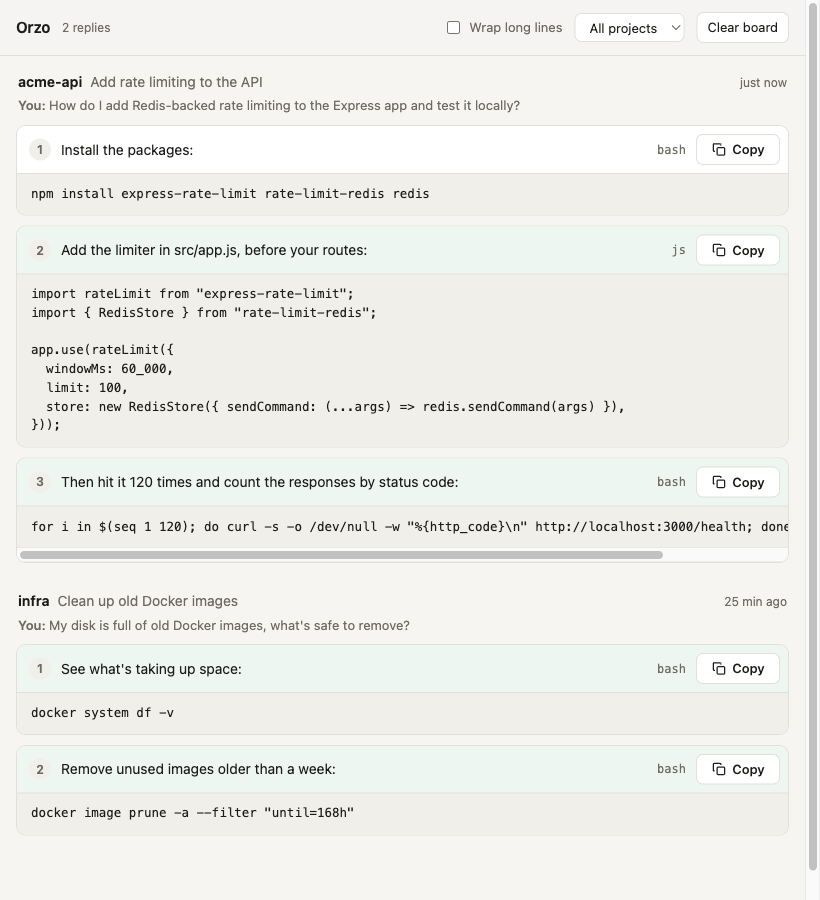

# Orzo

**Clean Claude Code snippets.**

I wiped out a production database one time because Claude Code wraps and indents its replies to fit your terminal window. Don't be old me, be like new me and use Orzo.

Copying a Claude generated multiline or text wrapped command or snippet out of the terminal often brings the hidden line breaks and indents from the layout. Orzo attempts to solve this. Whenever Claude finishes a reply, Orzo pulls out the code blocks exactly as written and shows them as cards on a small local board. Click **Copy**, and you get the real text.



- **In order.** Each reply's snippets are numbered in the order Claude gave them, labelled with the sentence just above each one. Newest reply on top.
- **Tracks your copy.** A snippet's header is lightly tinted until you copy it, so in a multi-step reply you can see which ones you've run.
- **All sessions.** Filter by project when you have several sessions going.
- **History saved.** If you want. Clean it up anytime.

## Install

In Claude Code:

```
/plugin marketplace add nickpagz/orzo
/plugin install orzo@orzo
```

Then restart Claude Code. Orzo starts its board when a session starts, and captures snippets from then on.

**Requirements:** Python 3.8 or later available as `python3`. Nothing else to install: Orzo uses only the Python standard library.

## Usage

Open the board with:

```
/orzo:open
```

It opens as its own window when Chrome, Chromium, Edge or Brave is installed, and in your default browser otherwise. You can also bookmark http://127.0.0.1:4977.

### Send anything to Orzo

Code blocks are captured automatically. For anything else you want to copy cleanly, ask Claude to send it to Orzo:

- "Send the README to Orzo"
- "Write a reply to Sam and put it in Orzo"
- "Send that last paragraph to Orzo as plain text"

It arrives as a card marked **Sent**, exactly as written: markdown stays markdown, indents and blank lines stay put, and files are sent straight from disk, never retyped. You can also type `/orzo:send` followed by what you want.

**Tip for macOS:** to get a Dock or Spotlight launcher, run this once:

```bash
osacompile -o ~/Applications/Orzo.app -e 'do shell script "open -na \"Google Chrome\" --args --app=http://127.0.0.1:4977"'
```

## How it works

- A `Stop` hook runs when each reply finishes. It reads the reply from the session transcript, extracts the fenced code blocks in order, and appends them to a local file.
- A `SessionStart` hook makes sure the board server is running. The server listens on `127.0.0.1` only and serves a single page that checks for new snippets every couple of seconds.
- A `send` skill lets Claude put a file or text on the board directly, through `scripts/orzo_send.py`. Sent cards join the reply they came from.
- Both hooks exit quietly on any error, so Orzo can never block or break a session.

## Your data

Snippets often contain things like hostnames, paths or tokens, so Orzo keeps everything on your machine:

- Snippets are stored only on your computer, in a file readable only by you:
  - macOS: `~/Library/Application Support/orzo/`
  - Linux: `~/.local/share/orzo/` (or `$XDG_DATA_HOME/orzo/`)
  - Windows: `%APPDATA%\orzo\`
- The board is reachable only from your own machine (`127.0.0.1`), and it rejects requests from other websites, including DNS-rebinding tricks.
- Nothing is sent anywhere. Orzo has no network code beyond the local board.
- **Clear board** archives the current snippets to a dated file in the same folder. Delete those files whenever you like.

## Settings

| Environment variable | Default | What it does |
|---|---|---|
| `ORZO_PORT` | `4977` | Port for the local board |
| `ORZO_DIR` | see [Your data](#your-data) | Where snippets are stored |

## Uninstall

```
/plugin uninstall orzo@orzo
```

The board server stops at your next restart or logout. To remove your saved snippets as well, delete the data folder listed above.

## License

MIT
